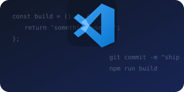

### Full-Stack Developer · BSIT Student · Web3 Explorer

Building practical web, mobile, and desktop experiences — from polished interfaces to reliable backend services.

---

### About me

<table>
  <tr>
    <td>
      <strong>Full-Stack Developer · BSIT Student</strong>  
      I'm a fourth year BS Information Technology student at the University of Mindanao – Tagum Campus, based in Tagum City, Philippines. I like turning ideas into useful software and learning by building across different platforms.  
      <strong>Interests</strong> 
      Full stack and backend development · Mobile apps · Desktop app development · Web3 and Solana  
      <strong>Currently learning</strong> 
      Solana smart contracts and Rust
    </td>
  </tr>
</table>

### Languages

JavaScript · TypeScript · C# · Dart · Rust (learning)

### Floating skill logos

  

### Tools & technologies

React.js · React Native · HTML · CSS · Tailwind CSS · WPF · Vite · Node.js · Express.js · REST APIs · Firebase · Firebase Realtime Database · Supabase · C# .NET Core · Expo · Flutter · Solana · Rust · Web3 Wallet Integration (Phantom, Solflare) · Claude Code · OpenAI Codex · GitHub Copilot · PostgreSQL · MySQL · Git · GitHub

### Currently exploring

`Solana & Rust` &nbsp; `Desktop applications` &nbsp; `AI-assisted development`

### VS Code mode

 

> “Code is like humor. When you have to explain it, it's bad.”

