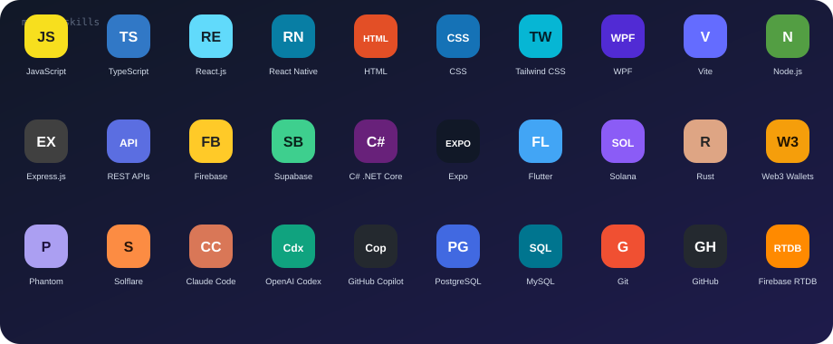
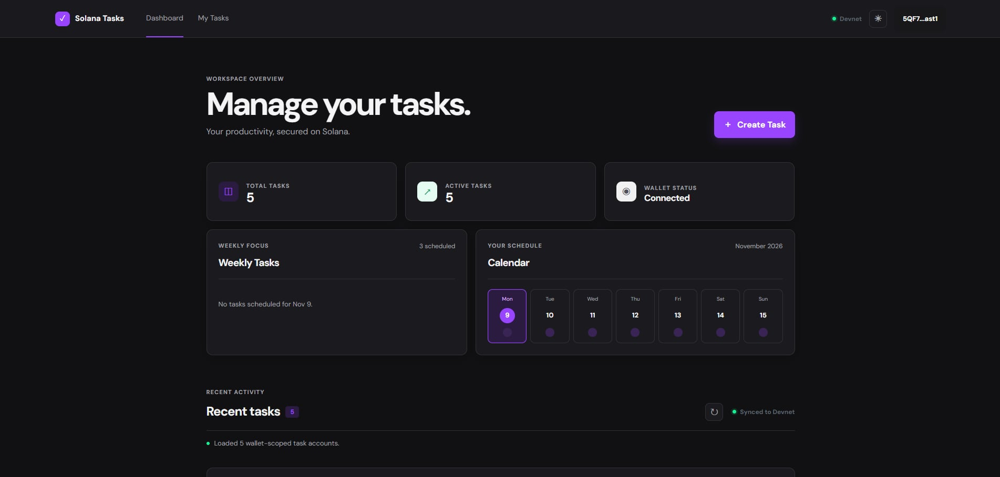
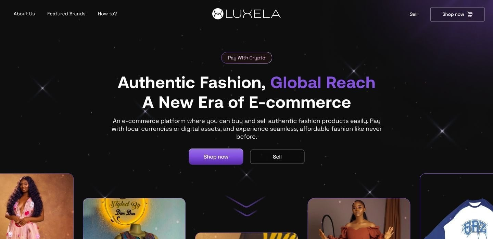
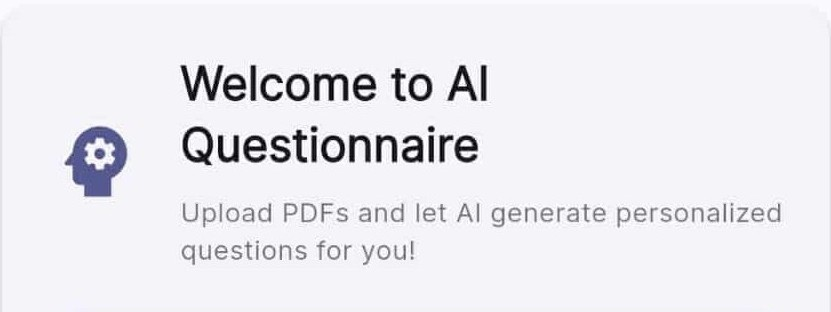

<div align="center">

<!-- Keep the assets/ folder alongside this README when copying it to the profile repository. -->


# MARVIN BONALOS


**Full-Stack Developer | Web Developer | Web3 Enthusiast**

Building digital experiences through code and creativity: useful web and mobile apps, backend systems, and explorations in blockchain.

[](https://marvbonportfolio.me/)
[](https://github.com/Boniechan)
[](https://www.linkedin.com/in/marvin-bonalos-413928344/)
[](mailto:bonalos.marvin8@gmail.com)

</div>

---

## About me

<table>
  <tr>
    <td>
      <strong>Background</strong><br />
      I'm a fourth-year Bachelor of Science in Information Technology student at the University of Mindanao – Tagum Campus in Tagum City, Philippines. I have hands-on project experience with full-stack and backend development, mobile apps, REST APIs, and blockchain integration.<br /><br />
      <strong>Interests</strong><br />
      Web, mobile, and desktop application development; backend systems; Solana and Web3; and AI-assisted development tools.<br /><br />
      <strong>Open to</strong><br />
      Full-stack roles, Web3 collaborations, and internships.<br /><br />
      <strong>How I like to build</strong><br />
      Practical problem solving, readable code, clean architecture, and continuous learning.
    </td>
  </tr>
</table>

## Tech stack

### Frontend development

<p>
  
</p>

React Native · WPF (Windows Presentation Foundation)

### Backend development

<p>
  
</p>

REST APIs · Firebase Realtime Database

### Mobile development

<p>
  
</p>

React Native · Expo

### Blockchain and Web3

<p>
  
  
</p>

Solana · Rust (learning) · Web3 wallet integration with Phantom and Solflare

### Databases

<p>
  
</p>

PostgreSQL · MySQL · Firebase Realtime Database

### Development tools

<p>
  
</p>

[](https://claude.ai/code)
[](https://openai.com/codex/)
[](https://github.com/features/copilot)

### Animated skill constellation

<p align="center">
  
</p>

## Featured projects

### Solana Tasks

<table>
  <tr>
    <td width="38%"><a href="https://solana-tasks.preview.dev"></a></td>
    <td>
      <strong>Decentralized task management on Solana.</strong><br /><br />
      Built with React, TypeScript, Rust, and Solana. Connect a wallet and manage tasks stored on-chain using Program Derived Addresses (PDAs).<br /><br />
      <strong>Features:</strong> Phantom and Solflare wallet adapters · on-chain task creation and completion · PDA-based user accounts · Devnet transactions and status · optimistic UI updates.<br /><br />
      <a href="https://solana-tasks.preview.dev">Live demo</a>
    </td>
  </tr>
</table>

### Luxela

<table>
  <tr>
    <td width="38%"></td>
    <td>
      <strong>Web3 e-commerce concept for independent fashion brands.</strong><br /><br />
      Backend project work focused on Node.js and Express REST APIs, TypeScript, and Solana wallet integrations. The portfolio marks this project as inactive.<br /><br />
      <strong>Stack:</strong> Node.js · Express.js · TypeScript · React.js · Solana · REST APIs · Web3.js<br /><br />
      <strong>Features:</strong> API endpoints for catalog and order flows · Phantom and Solflare wallet verification · inventory and order-state handling · frontend/backend integration.<br /><br />
      <sub>Repository and live demo links are not listed in the portfolio.</sub>
    </td>
  </tr>
</table>

### AI Questionnaire App

<table>
  <tr>
    <td width="38%"><a href="https://aiquestionaire-532d3.web.app/"></a></td>
    <td>
      <strong>Generate quizzes from study documents with AI.</strong><br /><br />
      The portfolio lists Dart, Flutter, Google Gemini AI, and Firebase for this app, which generates quizzes from PDF and PowerPoint files.<br /><br />
      <strong>Features:</strong> document-based quiz generation · Firebase synchronization · achievement tracking.<br /><br />
      <a href="https://aiquestionaire-532d3.web.app/">Live demo</a>
    </td>
  </tr>
</table>

## GitHub activity

These cards load live public data for [@Boniechan](https://github.com/Boniechan); values and language percentages are generated by the linked services.

<div align="center">

<br />

<a href="https://github.com/Boniechan"></a>

<br />

### Contribution calendar


</div>

## Connect

<div align="center">

[](https://marvbonportfolio.me/)
[](https://github.com/Boniechan)
[](https://www.linkedin.com/in/marvin-bonalos-413928344/)
[](mailto:bonalos.marvin8@gmail.com)

</div>

---

<div align="center">

### `</>` &nbsp; A note from the terminal

```text
> "Code is like humor. When you have to explain it, it's bad."
```

</div>
